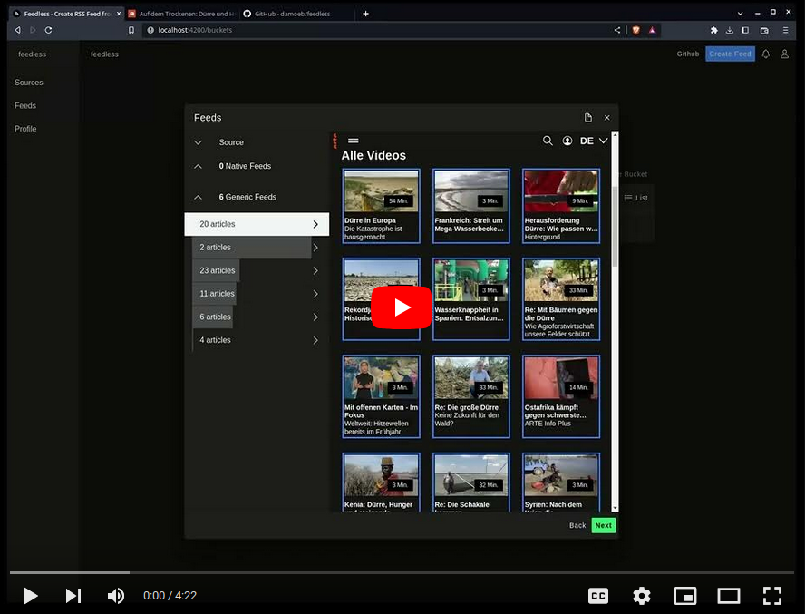

# RSS-proxy 

RSS-proxy allows you to do create an ATOM or JSON feed of any static website or feeds (web to feed),
just by analyzing just the HTML structure. Usually the structuring to a feed works automatically.
[Try the demo](https://rssproxy.migor.org). It is based on [feedless](https://github.com/damoeb/feedless), hence for simplicity all sources are co-located in the [feedless repository](https://github.com/damoeb/feedless/tree/develop/packages/app-web/src/app/products/rss-builder).

[](https://www.youtube.com/watch?v=7weraU_FpUs)

## Features
- Web to Feed
- Filters
- Fulltext Feed
- Privacy Plugins
- Custom feed parser rules
- JavaScript Support using chromium
- Self Hosting

## Version 3.x (Latest)

Once you have [docker-compose](https://docs.docker.com/compose/install/) or [podman-compose](https://docs.podman.io/en/latest/markdown/podman-compose.1.html), here is the basic setup.
It will start a database and feedless serving the RSS Proxy user interface.
```bash

wget https://raw.githubusercontent.com/damoeb/rss-proxy/develop/selfhosting.env \
  https://raw.githubusercontent.com/damoeb/rss-proxy/develop/docker-compose.yml \
  https://raw.githubusercontent.com/damoeb/rss-proxy/develop/chrome.json
touch your-license.key
docker-compose up
```

Then, open http://localhost:8080 in your browser

## Version 2.x
This version was written in kotlin and angular.

If you have [docker](https://docs.docker.com/install/) or [podman](https://podman.io/getting-started/installation) installed, do this

```
docker pull damoeb/rss-proxy:2.1
docker run -p 8080:8080 -e APP_API_GATEWAY_URL=https://foo.bar -it damoeb/rss-proxy:2.1
```

`APP_API_GATEWAY_URL` is your outfacing url, which will be used as host for feeds you create.

Then open [localhost:8080](http://localhost:8080) in the browser.

## Version 1.x
This was the prototype, written in node and angular. 

If you are interested in running the first prototype, this is how you do it.

```
docker pull damoeb/rss-proxy:1
docker run -p 3000:3000 -it damoeb/rss-proxy:1
```

Then open [localhost:3000](http://localhost:3000) in the browser.

## License

RSS-proxy is released under non-competitive FSL license, that falls back to Open Source Apache 2 after two years ([FSL-1.0-Apache-2.0](https://fsl.software/)).
