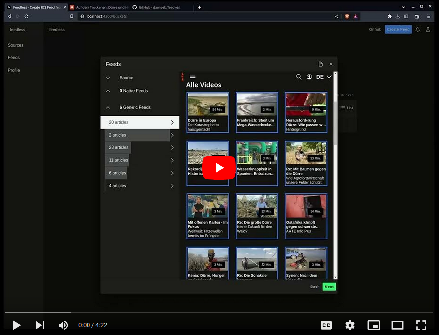

# {{apps.rss-proxy.title}} 

{{ apps.rss-proxy.descriptionMarkdown }}
[Try the demo](https://rssproxy.migor.org). It is based on [feedless](https://github.com/damoeb/feedless), hence for simplicity all sources are co-located in the [feedless repository](https://github.com/damoeb/feedless/tree/develop/packages/app-web/src/app/products/rss-builder).

[]({{{apps.rss-proxy.videoUrl}}})

## Features
{{#apps.rss-proxy.features}}
- {{{.}}}
{{/apps.rss-proxy.features}}

## Version 3.x (Latest)

{{{localSetup}}}
{{{apps.rss-proxy.localSetupBeforeMarkup}}}
```bash
{{{apps.rss-proxy.localSetupBash}}}
```
{{{apps.rss-proxy.localSetupAfterMarkup}}}

## Version 2.x
This version was written in kotlin and angular.

If you have [docker](https://docs.docker.com/install/) or [podman](https://podman.io/getting-started/installation) installed, do this

```
docker pull damoeb/rss-proxy:2.1
docker run -p 8080:8080 -e APP_API_GATEWAY_URL=https://foo.bar -it damoeb/rss-proxy:2.1
```

`APP_API_GATEWAY_URL` is your outfacing url, which will be used as host for feeds you create.

Then open [localhost:8080](http://localhost:8080) in the browser.

## Version 1.x
This was the prototype, written in node and angular. 

If you are interested in running the first prototype, this is how you do it.

```
docker pull damoeb/rss-proxy:1
docker run -p 3000:3000 -it damoeb/rss-proxy:1
```

Then open [localhost:3000](http://localhost:3000) in the browser.

## License

{{apps.rss-proxy.title}} {{{license}}}
